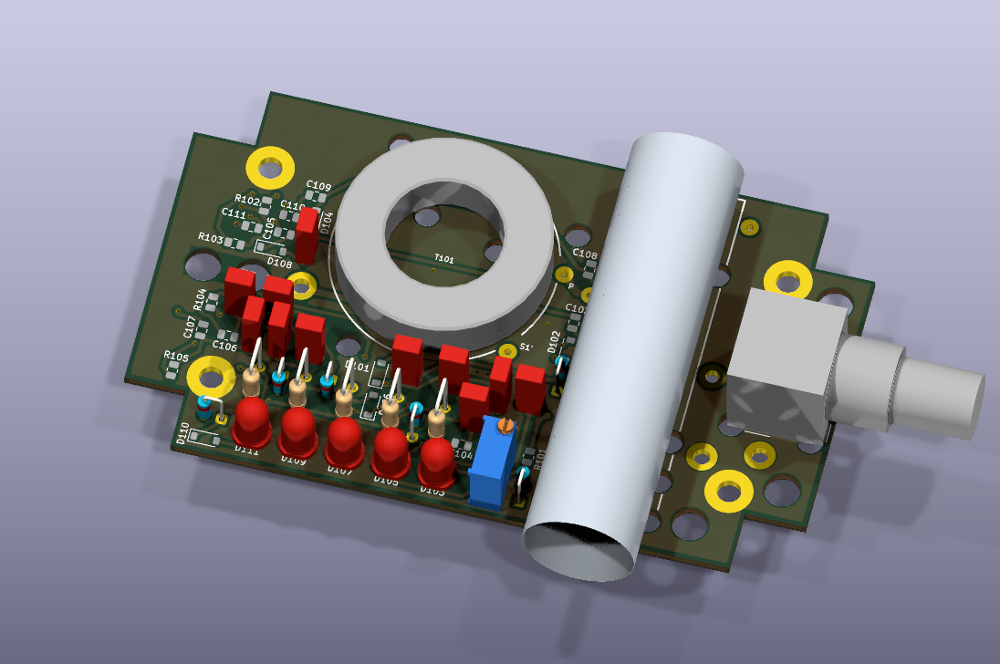

# SignalStreamer
A simple, compact, effective 80m radio orienteering transmit antenna

SignalStreamer is an 80-meter-band radio-orienteering (ARDF) transmit antenna kit designed to operate in the Amateur Radio Service 3.5 MHz to 3.7 MHz frequency range. The antenna is the perfect complement to the SignalSlinger 80m transmitter. It even fits into an identical box!

The SignalStreamer project is 100% Open Source. All the KiCad hardware design documents are available for download from this GitHub repository.

User Manual: <a href="https://docs.google.com/document/d/1ixdft7eyVAQ5lvPSUMsNJx15NzzCWhzimSsPBIRxByI/edit?usp=sharing">Assembly & User Manual</a>.

A matching transmitter: <a href="https://github.com/OpenARDF/SignalSlinger">SignalSlinger</a>.

## Rev 1.2 dual-assembly prototype

The [KiCad 10 project](KiCad/SignalStreamer.kicad_pro) fits either a machine-placed SMD detector or a fully hand-built through-hole detector on one PCB. All 11 capacitors, 5 fixed resistors and 11 diodes have paired footprints. Both builds use the Rev 1.1 circuit, the same through-hole RV101 trimmer, L101 inductor, T101 transformer and J105 BNC, and the same machined Polycase enclosure. The [assembly guide](Docs/Assembly-1.2.md) links the two BOMs, placement and fabrication files, FreeCAD model, machining drawing and first-article checks. Earlier Gerbers and the earlier board STEP remain under `KiCad/`. Use `Manufacturing/1.2-prototype/` for this revision.

On macOS, double-click [Open SignalStreamer Design.command](Open%20SignalStreamer%20Design.command) in Finder to open the KiCad 10 project and the [FreeCAD enclosure](Mechanical/SignalStreamer-enclosure.FCStd) together. In the KiCad project tree, double-click `SignalStreamer.kicad_pcb` to review the layout or `SignalStreamer.kicad_sch` to review the circuit.
